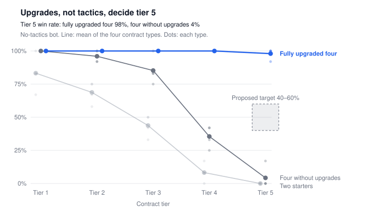

# Neon Directive: Balancing the Late Campaign

November 5, 2026 · Marco Machado

## Summary

After about six wins, upgrades outgrow Neon Directive's difficulty curve and tactics stop deciding outcomes. At tier 5, a fully upgraded squad with no tactics wins 98% of contracts on average, alarm raised every time. The same four operatives without upgrades win 4%.

That breaks the design pillar, engagement control, for the rest of the campaign. Credits are the only reward for quiet play, and once everything is bought they have no use.

Games that keep tactics mattering do four things. They escalate with new threats rather than bigger numbers. They grow the player's options more than raw power. They reward careful play with something that keeps its value. And they measure balance with bots of more than one skill level.

Recommended order: add a tactical bot to `scripts/balance.ts`, rework the weapon and armor upgrades, make repeat alarms escalate within a mission, then add badges and an opt-in difficulty ladder for the endgame. Do not scale hostiles to the squad's own strength: that is what made Oblivion's progression feel pointless.

## The problem



Source: `scripts/balance.ts`, no-tactics bot, 12 seeds per contract type and tier, run on commit `b1eeb1f`, November 4, 2026.

A fully upgraded squad needs no tactics at any tier, and it gets there fast. Maxing four operatives costs 4,850 credits, which is 6 wins played loud or 5 played quiet. The game agrees: `threatFor` rates tier 5 as low threat for that squad.

Quiet play stops paying at the same point. The bot raised the alarm in 75–100% of runs for every roster and tier, and the upgraded squad still won. Credits, the only reward for staying quiet, have nothing left to buy.

The causes and their levers in the code are listed below.

## Techniques from other games

Eleven techniques recur across the sources, from tactics, stealth and roguelike games. Primary means a developer or the original paper wrote it; secondary means a wiki, guide or unattributed summary.

### A one-way, readable alarm

[Invisible, Inc.](https://www.gamedeveloper.com/design/game-design-deep-dive-alarm-systems-in-klei-s-i-invisible-inc-i-) · primary: Klei designer James Lantz

The alarm runs 0 to 6, with five sub-steps per level. It rises every turn and on kills or found bodies. Level 2 raises firewalls, level 3 adds a patrol, and a tooltip warns of the next level. Klei made it deterministic because random consequences clash with planning.

### Failure changes the situation instead of rewinding it

[Invisible, Inc.](https://www.gamedeveloper.com/design/lesson-the-problems-of-modern-stealth-design-and-how-invisible-inc-solves-them) · design analysis

Failed missions cannot be replayed by default. Lost agents can be rescued at a cost, and only a full wipe ends the campaign. Suspicious guards search and check behind cover.

### New threats on a schedule, not just bigger numbers

[XCOM 2](<https://ufopaedia.org/index.php/Difficulty_(XCOM2)>) · secondary: community wiki

Stronger enemy types join on the campaign calendar. On Legend they arrive later (Sectopods in October instead of August), and enemy HP rises with difficulty.

### Watch relative power, not absolute power

[Schreiber's Game Balance Concepts](https://gamedesignaspect.blogspot.com/2013/04/advancement-progression-and-pacing-part.html) · secondary: adaptation of the course

Check that player power grows at a good rate against enemy power. Too fast makes the rest of the game trivial; too slow forces grinding. Endless games need an "elder game" once the player peaks.

### Do not level the world with the player

[Oblivion](https://www.videogamer.com/news/elder-scrolls-iv-oblivion-levelling-system-mistake-admits-designer-haunts-remaster) · primary: designer interview

The world scaled with the hero, so progress felt erased. Designer Bruce Nesmith called it a mistake. Skyrim kept players challenged without dungeons leveling alongside them.

### Grow options alongside power

[Game Developer on progression](https://gamedeveloper.com/design/the-fundamentals-of-game-progression) · primary: design article

Vertical progression adds scale; horizontal progression adds tools. Most games mix both for each concept. Pure stat growth risks boredom and endless escalation.

### Unlock variety, not strength

[Slay the Spire](https://saschb2b.github.io/game-mechanics/games/slay-the-spire/design-tensions) · secondary: unattributed summary

Meta-progression reportedly unlocks new options rather than starting power, so each run still has to be earned.

### Opt-in difficulty after mastery

[Hades](https://saschb2b.github.io/game-mechanics/games/hades/meta-progression) · secondary: summary

The Pact of Punishment unlocks after the first win. Stackable Conditions, such as more enemy damage or pricier shops, each add Heat and a reward bonus.

### Rewards for how a mission was played

[Desperados III](https://www.gamepressure.com/desperados-iii/badges-list-why-cant-i-see/z1d049) · secondary: game guide

Badges are per-mission challenges: time limits, passing an area without attacking, no saves. They are revealed after the first completion, and one run rarely earns them all.

### Preparation lowers the opposition

[Long War 2](<https://ufopaedia.org/Missions_(LW2)>) · secondary: community wiki

Infiltration sets enemy strength. At 0% it is several activity steps above base, at 100% the base, and at 200% a few steps below.

### Bots of more than one skill level

[EA, The Sims Mobile](https://ar5iv.arxiv.org/html/1811.06962) · primary: research paper

A near-optimal A\* agent ran on a fast simulator and a weaker Softmax agent on the real client. Averages over 1,000 runs found an event needing about 13 actions where most needed 3 or 4, and a reward not worth its effort.

[Horizon Zero Dawn](https://gamedeveloper.com/design/designing-the-stealth-economy-and-encounters-of-i-horizon-zero-dawn-i-) adds a caution: its economy was easy to check early but hard over 50 to 100 hours, and most tuning landed in the final two years.

## How the techniques map onto Neon Directive

Each technique has a concrete lever in the code. Paths are relative to the repository root; line numbers are as of commit `b1eeb1f`.

- **Bots of more than one skill level**
  - Today: one bot, with no tactics, in `scripts/balance.ts`.
  - Change: add a tactical bot that uses takedowns and silent volleys and waits out vision cones. Judge every change by the gap between the two bots.
- **Watch relative power**
  - Today: weapon upgrades add 12 damage a level (Assault 28 to 64, +129%) and armor adds 40 HP a level (140 to 260, +86%). Tier 5 hostiles get only ×1.40 HP and ×1.46 damage.
  - Code: `WEAPON_BONUS` and `ARMOR_BONUS` at `src/game/simulation.ts:101`; `tierHp` and `tierDamage` at `src/game/simulation.ts:70`.
  - Change: shrink the gear increments, or steepen tiers 4 and 5, until the upgraded no-tactics bot hits the target.
- **Grow options alongside power**
  - Today: weapon and armor are pure stat growth. Ability upgrades give −15% cooldown and +20% effect a level.
  - Code: `applyPurchase` in `src/game/campaign.ts`; `src/game/classes.ts`.
  - Change: turn some gear levels into trade-offs, such as a suppressor that keeps a volley quiet against raw damage.
- **New threats, not bigger numbers**
  - Today: tiers add more of the same four kinds: guards 3 + tier, heavies tier ÷ 2 rounded down, cameras tier − 1, turrets from tier 4.
  - Code: `planMission` at `src/game/mapgen.ts:129`.
  - Change: give tiers 4 and 5 new behavior, such as guards that check behind cover, faster detection and quicker waves.
- **Do not level the world with the player**
  - Today: `squadRating` and `threatFor` in `src/game/campaign.ts` already measure the squad. Feeding them into hostile stats would repeat Oblivion.
  - Change: keep tiers fixed and let the player choose harder ones.
- **A one-way, readable alarm**
  - Today: the alarm is on or off, and the stand-down clears it. The cap of 8 reinforcements covers the whole mission, so a second alarm brings no new waves.
  - Code: `raiseAlarm`, `reinforce` and `REINFORCE_CAP` in `src/game/simulation.ts`.
  - Change: keep the stand-down, which is part of the core system, but make each later alarm in a mission worse. Show what the next one brings.
- **Failure changes the situation**
  - Today: the mission menu restarts any mission for free, and the server accepts the active contract again.
  - Code: `restart` in `src/game/simulation.ts`; `startMission` in `src/game/campaign.ts`.
  - Change: a design call, to price restarts or keep them free (see open questions).
- **Rewards for how a mission was played**
  - Today: quiet play earns only the 25% stealth bonus, in credits.
  - Code: `STEALTH_BONUS` and `missionPayout` in `src/game/campaign.ts`.
  - Change: badges per contract (never seen, no kills, under a time), shown on the board and in the debrief.
- **Opt-in difficulty after mastery**
  - Today: from 6 wins the board cycles tiers 3 to 5 forever, and the campaign never ends.
  - Code: `offerTiers` and `baseTier` in `src/game/campaign.ts`.
  - Change: Heat-style contract modifiers once the squad is maxed, such as no reinforcement cap, faster detection and a longer stand-down.

Long War 2's infiltration has no close equivalent here; the nearest is patrol intel, which already rewards scouting.

## Pitfalls to avoid

Each of these undoes a fix or breaks something the game already does well.

- **Scaling hostiles to the squad.** It erases the feeling of progress; Oblivion's designer called it a mistake. Keep tiers fixed and let players pick harder ones.
- **Random alarm consequences.** Klei dropped them because they clash with planning. Every escalation step should be known in advance and shown before it happens.
- **Tuning against one kind of bot.** EA's near-optimal bot showed what is achievable, not what typical players do. Tune to the gap between a no-tactics bot and a tactical one, then check with people.
- **Upgrade options that feel useless.** Horizontal choices only work if each one wins somewhere. A trade-off nobody picks is a wasted slot.
- **Hidden rewards.** Desperados III reveals badges only after the first completion, so chasing them means replaying the mission. Show a contract's badges on the board before deploying.
- **Removing the stand-down.** The README names it as how a loud engagement ends. Make later alarms costlier instead of taking away the way out.

## Recommended plan

Measure first, then fix the root cause, then add the endgame. Each step lands on its own and is checked with `scripts/balance.ts`.

1. **Add a tactical bot.** It uses takedowns and silent volleys and waits out vision cones. Done when both bots cover every contract type and tier, with a new baseline saved beside `scripts/balance-baseline.txt`.
2. **Rework weapon and armor.** Shrink the increments, add trade-offs, or both. Done when the targets below hold.
3. **Escalate repeat alarms within a mission.** Done when a second alarm brings something the first did not, shown before it lands, with unit tests covering it.
4. **Add badges per contract.** Done when the board shows each contract's badges before deploying and the debrief records the ones earned.
5. **Add opt-in modifiers after max.** Done when a fully upgraded squad can raise a contract's difficulty and earn a reward for it.

Proposed targets for step 2, to confirm before tuning:

| Bot | Roster | Tier | Now | Target |
| --- | --- | --- | --- | --- |
| No tactics | Fully upgraded four | 5 | 98% | 40–60% |
| Tactical | Fully upgraded four | 5 | untested | 85%+ |
| No tactics | Two starters | 1 | 83% | 83% |
| Tactical | Two starters | 1 | untested | 90%+ |

Current rates are means across the four contract types. The tactical bot does not exist yet.

The existing test of contract 01's quiet route must keep passing, so the first contract stays hand-checked.

## Open design questions

These are the owner's calls; the plan above waits on the first three.

- [ ] Are the proposed win-rate targets right?
- [ ] Gear: smaller increments, trade-off choices, or both?
- [ ] What should a second alarm in a mission bring: heavies, faster waves, a longer stand-down, or a higher reinforcement cap?
- [ ] Should restarts stay free? Today any mission restarts at no cost, so an alarm never has a lasting price.
- [ ] Should the campaign end? A final contract gives progression a finish line; an endless board needs an endgame such as opt-in modifiers.
- [ ] What should badges earn: recognition only, clearance, or access to harder contracts?

## Method and reproduction

The numbers come from `main` at commit `b1eeb1f`, level with `origin/main` on November 4, 2026. All 152 unit tests and the typecheck passed on that commit.

- **Balance runs.** The no-tactics bot in `scripts/balance.ts` selects the whole squad, clicks the objective, then extraction. It revives the downed and uses no abilities. It played 12 seeds per contract type and tier, with a 300 s limit, for three rosters: the two starters, four operatives, and four fully upgraded.
- **Cost to max.** 4,850 credits: two recruits (800), three weapon levels (900), three armor levels (750), and three levels for each of four classes (2,400). Taking the top-tier offer every time, that is 6 wins played loud or 5 played quiet, from `topTier`, `contractPayout` and `STEALTH_BONUS`.
- **Threat read.** `squadRating` gives a fully upgraded four 3.6, so a tier 5 contract sits 0.4 tiers above it and `threatFor` reads it as low.
- **Web research.** Done on November 4 and 5, 2026; the pages opened are under Sources. The Game Developer articles, the VideoGamer interview and the EA paper are primary. The XCOM 2, Long War 2, Slay the Spire, Hades and Desperados III entries rest on wikis, guides or summaries.

To rerun the balance check:

```bash
node --experimental-transform-types /Users/machado/Projects/directive/scripts/balance.ts
```

Add `--seeds 6`, `--roster four+max` or `--tiers 4,5` to narrow it. A full run took about 24 s.

## Sources

- [Game design deep dive: alarm systems in Klei's Invisible, Inc.](https://www.gamedeveloper.com/design/game-design-deep-dive-alarm-systems-in-klei-s-i-invisible-inc-i-) (Game Developer)
- [The problems of modern stealth design, and how Invisible Inc. solves them](https://www.gamedeveloper.com/design/lesson-the-problems-of-modern-stealth-design-and-how-invisible-inc-solves-them) (Game Developer)
- [Exploring Gameplay With AI Agents](https://ar5iv.arxiv.org/html/1811.06962) (EA, The Sims Mobile)
- [Elder Scrolls IV: Oblivion's levelling system was a "mistake", admits designer](https://www.videogamer.com/news/elder-scrolls-iv-oblivion-levelling-system-mistake-admits-designer-haunts-remaster) (VideoGamer)
- [The fundamentals of game progression](https://gamedeveloper.com/design/the-fundamentals-of-game-progression) (Game Developer)
- [Designing the stealth economy and encounters of Horizon Zero Dawn](https://gamedeveloper.com/design/designing-the-stealth-economy-and-encounters-of-i-horizon-zero-dawn-i-) (Game Developer)
- [Advancement, progression and pacing, part I](https://gamedesignaspect.blogspot.com/2013/04/advancement-progression-and-pacing-part.html) (Game Design Aspect, from Ian Schreiber's Game Balance Concepts)
- [Difficulty (XCOM 2)](<https://ufopaedia.org/index.php/Difficulty_(XCOM2)>) (UFOpaedia)
- [Missions (Long War 2)](<https://ufopaedia.org/Missions_(LW2)>) (UFOpaedia)
- [Slay the Spire: design tensions](https://saschb2b.github.io/game-mechanics/games/slay-the-spire/design-tensions) (summary)
- [Hades: meta-progression](https://saschb2b.github.io/game-mechanics/games/hades/meta-progression) (summary)
- [Desperados III challenges (badges)](https://www.gamepressure.com/desperados-iii/badges-list-why-cant-i-see/z1d049) (Gamepressure guide)
